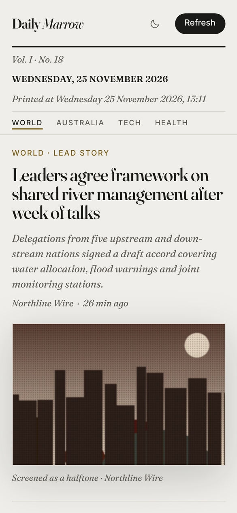

<div align="center">

# Daily Marrow

**A self-hosted daily news digest, set like a printed newspaper.**

Daily Marrow pulls about thirty RSS, Atom and YouTube feeds, folds them into a single edition,
and serves it as a calm, newspaper-style front page with a built-in reader.
Pure Python standard library on the back end, one HTML file on the front. No accounts, no tracking, no AI.

[](https://github.com/doctorniz/DailyMarrow/actions/workflows/docker-build.yml)


<sub>Rendered from a sample edition with placeholder headlines and images.</sub>

</div>

---

## Contents

- [Features](#features)
- [Screenshots](#screenshots)
- [Quick start](#quick-start)
- [Settings page](#settings-page)
- [Server options](#server-options)
- [HTTP endpoints](#http-endpoints)
- [How it works](#how-it-works)
- [Project layout](#project-layout)
- [Testing](#testing)
- [License](#license)

## Features

- **Newspaper layout.** A lead story with a halftone-screened picture, picture cards for each desk, and multi-column newsprint for the rest.
- **Sectioned edition.** World, Australia, Europe, Middle East, Asia, Tech, Health and Sport out of the box, with a sticky section bar that tracks where you are.
- **Fair mixing.** Stories are deduplicated across the whole edition and interleaved by source, so no single outlet dominates the top of a section.
- **Built-in reader.** Click a story to read the extracted article text in a modal, with ads, navigation and paywall chrome stripped out, and a link back to the original.
- **Fresh on its own.** Fetches on startup when the edition is missing or stale, and a **Refresh** button re-prints it on demand (rate limited, so it is safe to expose).
- **Settings page.** Edit feeds, sections and refresh timings at `/settings`, behind an admin password. Saved on the server and applied without a restart.
- **Light and dark themes.** Follows the system setting, with a toggle that is remembered per browser.
- **Responsive.** Three columns on desktop, two on tablets (≤ 900 px) and one on phones (≤ 640 px).
- **Zero dependencies.** Runs on a stock Python 3.11 install or as a small Docker container.

## Screenshots

<table>
  <tr>
    <td width="72%"></td>
    <td width="28%"></td>
  </tr>
  <tr>
    <td align="center"><sub>Dark theme</sub></td>
    <td align="center"><sub>Phone layout</sub></td>
  </tr>
</table>

## Quick start

### With Docker (recommended)

```bash
git clone https://github.com/doctorniz/DailyMarrow.git
cd DailyMarrow
docker compose up -d
```

Open <http://localhost:5551>. The first edition is fetched in the background on startup and usually lands within a minute; reload the page once it is ready.

The compose file keeps `edition.json` and `settings.json` in a named volume (`news-data`), so rebuilding the image picks up front-end changes without losing the current edition or your settings. Then open <http://localhost:5551/settings> to choose your feeds (see [Settings page](#settings-page)).

To build and run the image by hand:

```bash
docker build -t daily-marrow .
docker run -d --name daily-marrow -p 5551:5551 -v news-data:/app/news daily-marrow
```

### Without Docker

Requires Python 3.11 or newer. There is nothing to install.

```bash
git clone https://github.com/doctorniz/DailyMarrow.git
cd DailyMarrow
python3 news_server.py
```

The server listens on <http://localhost:5551> and writes editions to `~/.hermes/news/` unless you set `NEWS_DIR`. You can also print an edition without starting the server:

```bash
NEWS_DIR=./news python3 news_fetch.py
```

> `edition.json` is generated, not committed. Until the first fetch finishes, the page shows *"No edition yet"*.

## Settings page

Feeds and timings are edited in the browser at **<http://localhost:5551/settings>** (also linked from the front page footer). Changes are saved to `settings.json` next to `edition.json` and apply straight away, with no rebuild or restart. In Docker that file lives in the `news-data` volume, so it survives image rebuilds.

<details>
<summary>What you can change there</summary>

- **Printing schedule.** How old the edition may get before it is re-printed automatically (checked on startup and once a minute; 0 turns this off), and the minimum gap between refreshes.
- **Desks and feeds.** Add, remove, rename and reorder sections; set each section's id, kind (`news`, or `curated` to collect without showing) and story cap; add or remove feeds, each with a name, URL and maximum age in hours. Feeds that failed in the last edition are flagged next to their URL.
- **Save & re-print now.** Saves and prints a fresh edition at once, skipping the refresh cooldown.
- **Restore the built-in feeds.** Drops your feed list and goes back to the defaults in `news_fetch.py`.
- **Admin password.** Change it, which also signs out every other browser.

</details>

### Signing in

The page changes how the server behaves, so it is behind an admin password.

- **First run.** Until a password exists, the server prints a one-time setup code to its log. Open `/settings`, enter the code and choose a password (at least 8 characters). With Docker, find the code with:

  ```bash
  docker compose logs daily-marrow | grep "setup code"
  ```

  A stranger who reaches the page first cannot claim it without that code.
- **Or set it yourself.** Set `NEWS_ADMIN_PASSWORD` and that password is used instead (it can then only be changed there).
- Passwords are stored as salted PBKDF2-SHA256 hashes in `settings.json`, which is written readable by the server's user only. Sign-ins last 12 hours, use an `HttpOnly`, `SameSite=Strict` cookie, and are limited to 10 attempts per IP every 10 minutes. If you expose the site to the internet, serve it over HTTPS (for example behind nginx) so the password is not sent in the clear.
- Forgot the password? Delete the `"admin"` entry from `settings.json` (or the whole file) and restart; a new setup code is printed.

## Server options

A few things are needed before the server starts, so they stay as environment variables (set in `docker-compose.yml`). The settings page shows their current values.

| Variable | Default | Description |
|---|---|---|
| `NEWS_PORT` | `5551` | Port the server listens on. |
| `NEWS_HOST` | `0.0.0.0` | Address the server binds to. |
| `NEWS_DIR` | `/app/news` in Docker, `~/.hermes/news` otherwise | Where `edition.json` and `settings.json` are kept. |
| `NEWS_STATIC_DIR` | The folder holding `news_server.py` if it contains `index.html`, else `NEWS_DIR` | Where `index.html`, `settings.html`, `fonts/` and the favicons are served from. |
| `NEWS_FETCHER` | `news_fetch.py` next to `news_server.py` | Fetcher script that refreshes run. |
| `NEWS_ADMIN_PASSWORD` | unset | Optional fixed admin password for the settings page. |
| `NEWS_TRUSTED_PROXIES` | `127.0.0.1,::1` | Reverse proxies (IPs or CIDR ranges) whose `X-Forwarded-For` header is believed, so rate limits apply per visitor. Behind nginx on the Docker host, add the bridge range, e.g. `127.0.0.1,::1,172.16.0.0/12`. |
| `FETCH_TTL_SECONDS` | `3600` | Starting value for the edition max age, until one is saved on the settings page. |
| `NEWS_REFRESH_COOLDOWN` | `900` | Starting value for the refresh cooldown, until one is saved on the settings page. |

Existing deployments keep working unchanged: `FETCH_TTL_SECONDS` and `NEWS_REFRESH_COOLDOWN` are honoured until you save the settings page once, after which the saved values win.

### Built-in feeds

Until you save your own list, the fetcher uses `DEFAULT_SECTIONS` at the top of [`news_fetch.py`](news_fetch.py), about thirty feeds across World, Australia, Europe, Middle East, Asia, Tech, Health and Sport. The first section with stories becomes the lead. Any RSS 2.0, RSS 1.0 (RDF) or Atom feed works, including YouTube channel feeds (`https://www.youtube.com/feeds/videos.xml?channel_id=…`).

## HTTP endpoints

| Method | Path | Description |
|---|---|---|
| `GET` | `/` | The front page. |
| `GET` | `/edition.json` | The current edition: sections, stories and any feed errors. |
| `GET` | `/read?url=<link>` | Extracted article text for the reader modal. Only links that appear in the current edition are accepted. |
| `POST` | `/refresh` | Starts a new fetch in the background. Returns `{"started": …, "running": …}`, plus `retry_in` while the cooldown is active. |
| `GET` | `/refresh-status` | Whether a fetch is running, when the last one started and its exit code. |
| `GET` | `/settings` | The settings page. |
| `GET`, `POST` | `/api/settings` | Read or save settings. Needs an admin sign-in. |
| `POST` | `/api/settings/login`, `/logout`, `/password` | Admin sign-in, sign-out and password change. |
| `GET` | `/fonts/*`, `/favicon.*` | Static assets. |

Nothing else is served, so the server source and `.git` folder are never exposed.

## How it works

```
 ┌──────────────┐   RSS / Atom / YouTube   ┌───────────────┐   edition.json   ┌──────────────┐
 │   33 feeds   │ ───────────────────────▶ │ news_fetch.py │ ───────────────▶ │ news_server  │ ──▶ browser
 └──────────────┘    fetched in parallel   └───────────────┘   (NEWS_DIR)     │   :5551      │
                                                    ▲                         └──────┬───────┘
                                                    └──── startup if stale / POST /refresh
```

1. **Fetch.** `news_fetch.py` pulls every feed in parallel, drops stories older than each feed's max age, deduplicates by link, interleaves sources and writes `edition.json` atomically.
2. **Serve.** `news_server.py` serves the page and the edition, and runs the fetcher in a subprocess on startup, when the edition gets older than its max age, or on refresh.
3. **Read.** The `/read` extractor is built to be public-facing: it only fetches links already in the edition, over HTTPS, to hosts that resolve to public IPs, re-checks every redirect, caps response size, rate limits each client and rebuilds the article from plain text and images so no third-party script reaches the browser.

## Project layout

```
.
├── index.html            # the whole front end (vanilla JS and CSS)
├── settings.html         # the settings page
├── news_fetch.py         # feed fetcher, writes edition.json
├── news_server.py        # HTTP server, reader extractor, refresh endpoints
├── fonts/                # self-hosted web fonts
├── Dockerfile
├── docker-entrypoint.sh  # drops root and runs the server as an unprivileged user
├── docker-compose.yml
├── tests/                # unit and HTTP tests (stdlib unittest, no network)
├── test-docker.sh        # smoke test of the Docker image (CI runs it too)
├── docs/                 # README screenshots
├── .github/workflows/    # CI: unit tests, Docker build and smoke test
└── LICENSE
```

## Testing

The `tests/` folder holds unit and HTTP tests for the fetcher, the settings validation, the reader's article extractor and its fetch guards, rate limits, admin sign-in and the server's request handling. They use only the standard library, run a real server on a random local port, and never touch the network (feeds and article fetches use saved samples in `tests/fixtures/`). Run them with:

```bash
python -m unittest discover -s tests
```

Every push and pull request to `main` also runs these tests, then builds the Docker image and smoke-tests the running container in GitHub Actions. The checks cover the pages and APIs, the security headers, the first edition, that the server runs as a non-root user, the container health check and a clean shutdown. Any failed check fails the build. To run the same checks locally:

```bash
./test-docker.sh               # build the image, then test it
SKIP_BUILD=1 ./test-docker.sh  # test an image you already built
```

## License

[MIT](LICENSE). Use it however you want.
